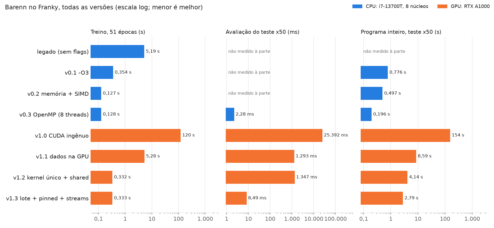

# Barenn: otimização em CPU e migração para GPU

Rede densa 64 → 32 → 16 → 10 do legado, treinada com SGD amostra por amostra (51 épocas). Otimizei a versão de CPU (memória, SIMD e OpenMP) e migrei para CUDA em quatro passos. Cada passo é um bloco com issue, PR e tag. **Todas as versões geram exatamente a mesma saída do legado.**

## Resultados

| Versão | O que mudou | Treino (s) | Avaliação x50 (ms) | Programa inteiro x50 (s) | Issue | Tag |
|---|---|---:|---:|---:|---|---|
| legado | código original, `g++ barenn.cpp` sem flags | 5,19 | – | – | [#1](https://github.com/felipebns/awful-barenn/issues/1) | – |
| **v0.1** (baseline) | Makefile `-O3`, referência e scripts | 0,354 | – | 0,776 | [#1](https://github.com/felipebns/awful-barenn/issues/1) | [`v0.1-baseline`](https://github.com/felipebns/awful-barenn/releases/tag/v0.1-baseline) |
| v0.2 | sem trabalho inútil, pesos contíguos, sem cópias, `-mavx2` | 0,127 | – | 0,497 | [#3](https://github.com/felipebns/awful-barenn/issues/3) | [`v0.2-cpu-memoria`](https://github.com/felipebns/awful-barenn/releases/tag/v0.2-cpu-memoria) |
| **v0.3** (CPU otimizada) | OpenMP na leitura e na avaliação (8 threads) | 0,128 | 2,28 | 0,196 | [#5](https://github.com/felipebns/awful-barenn/issues/5) | [`v0.3-cpu-openmp`](https://github.com/felipebns/awful-barenn/releases/tag/v0.3-cpu-openmp) |
| **v1.0** (CUDA inicial) | porte direto: kernels por operação, aloca e copia a cada chamada | 120,4 | 25.392 | 153,7 | [#7](https://github.com/felipebns/awful-barenn/issues/7) | [`v1.0-cuda-ingenuo`](https://github.com/felipebns/awful-barenn/releases/tag/v1.0-cuda-ingenuo) |
| v1.1 | pesos, ativações e dados residentes na GPU | 5,28 | 1.293 | 8,59 | [#9](https://github.com/felipebns/awful-barenn/issues/9) | [`v1.1-cuda-residente`](https://github.com/felipebns/awful-barenn/releases/tag/v1.1-cuda-residente) |
| v1.2 | treino num kernel só, modelo na memória compartilhada | 0,332 | 1.347 | 4,14 | [#11](https://github.com/felipebns/awful-barenn/issues/11) | [`v1.2-cuda-shared`](https://github.com/felipebns/awful-barenn/releases/tag/v1.2-cuda-shared) |
| **v1.3** (CUDA otimizado) | avaliação em lote, memória pinned e 2 streams | 0,333 | 8,49 | 2,79 | [#13](https://github.com/felipebns/awful-barenn/issues/13) | [`v1.3-cuda-streams`](https://github.com/felipebns/awful-barenn/releases/tag/v1.3-cuda-streams) |

Treino: 51 épocas com `optdigits.tra`. x50: `optdigits.tes` repetido 50 vezes (89.850 imagens, `scripts/teste_grande.sh 50`). Média de 5 execuções no Franky (v1.0: 3): CPU na fila `sunny_cpu`, nó compute10 exclusivo (i7-13700T, 8 núcleos no job, g++ 14.2; job 31094); GPU nas filas `pluton_gpu`/`sunny_gpu`, nó compute20 (RTX A1000, CUDA 12.8; jobs 31092, 31095 e 31108). `merry_cpu` e `sunny_cpu` usam os mesmos nós e só mudam o limite de tempo. "–": a versão não mede a avaliação separada. Todas as versões geram a mesma saída do legado (`scripts/validar.sh`).



## Índice

| Bloco | Issue (diagnóstico, hipótese e resultados) | PR | Tag |
|---|---|---|---|
| 1. Baseline reproduzível | [#1](https://github.com/felipebns/awful-barenn/issues/1) | [#2](https://github.com/felipebns/awful-barenn/pull/2) | [`v0.1-baseline`](https://github.com/felipebns/awful-barenn/releases/tag/v0.1-baseline) |
| 2. Memória e SIMD na CPU | [#3](https://github.com/felipebns/awful-barenn/issues/3) | [#4](https://github.com/felipebns/awful-barenn/pull/4) | [`v0.2-cpu-memoria`](https://github.com/felipebns/awful-barenn/releases/tag/v0.2-cpu-memoria) |
| 3. OpenMP | [#5](https://github.com/felipebns/awful-barenn/issues/5) | [#6](https://github.com/felipebns/awful-barenn/pull/6) | [`v0.3-cpu-openmp`](https://github.com/felipebns/awful-barenn/releases/tag/v0.3-cpu-openmp) |
| 4. CUDA inicial | [#7](https://github.com/felipebns/awful-barenn/issues/7) | [#8](https://github.com/felipebns/awful-barenn/pull/8) | [`v1.0-cuda-ingenuo`](https://github.com/felipebns/awful-barenn/releases/tag/v1.0-cuda-ingenuo) |
| 5. Dados residentes na GPU | [#9](https://github.com/felipebns/awful-barenn/issues/9) | [#10](https://github.com/felipebns/awful-barenn/pull/10) | [`v1.1-cuda-residente`](https://github.com/felipebns/awful-barenn/releases/tag/v1.1-cuda-residente) |
| 6. Kernel único e memória compartilhada | [#11](https://github.com/felipebns/awful-barenn/issues/11) | [#12](https://github.com/felipebns/awful-barenn/pull/12) | [`v1.2-cuda-shared`](https://github.com/felipebns/awful-barenn/releases/tag/v1.2-cuda-shared) |
| 7. Lote, pinned e streams | [#13](https://github.com/felipebns/awful-barenn/issues/13) | [#14](https://github.com/felipebns/awful-barenn/pull/14) | [`v1.3-cuda-streams`](https://github.com/felipebns/awful-barenn/releases/tag/v1.3-cuda-streams) |

## Análise

**CPU.** O `-O3` sozinho deu 14,7x (5,19 → 0,354 s); é ganho do compilador, por isso a base é a v0.1. O callgrind mostrou 36% das instruções num gradiente nunca usado e o maior custo na leitura dos pesos por coluna. Cinco commits (sem o trabalho inútil, pesos contíguos e transpostos, sem cópias, imagens contíguas, `-mavx2`) levaram o treino a 0,127 s: 2,8x sobre a v0.1 e 41x sobre o legado sem flags, ou 0,65 µs por amostra (23 GFLOP/s num núcleo). O treino não se divide entre threads, porque cada amostra depende da anterior. Por isso o OpenMP foi para a leitura e a avaliação, que crescem com os dados: no x50 o programa foi de 0,497 para 0,196 s (2,5x; 4,0x sobre a v0.1). Treino e `getline` são 31% do tempo serial, então o teto pela Lei de Amdahl é 3,25x, e o modelo acerta os tempos com 2, 4 e 8 threads com erro de ~1%. Com 16 threads não melhora, porque o job só tem 8 CPUs.

**GPU.** Cada versão atacou o que o Nsight Systems mostrou na anterior:

| Versão | Gargalo encontrado | Mudança | Ganho |
|---|---|---|---|
| v1.1 | v1.0 com 98% do tempo em `cudaMalloc`/`cudaMemcpy`/`cudaFree` (160 mil alocações e 172 mil cópias de 0,9 KB por época, 0,19 GB/s efetivos) | dados residentes na GPU | 23x |
| v1.2 | 11 kernels e 2 cópias por amostra | treino num kernel só, de ~2,1 milhões de lançamentos para 1 | 16x |
| v1.3 | 3 kernels e 1 cópia por imagem | avaliação em lote, pinned e streams | 159x na avaliação |

Da v1.0 para a v1.3, o treino ficou 362x mais rápido e a avaliação do x50, 3.000x.

**Por que a GPU ainda perde.**

- **Treino:** o SGD sequencial só permite 1 bloco, 8 warps em 1 dos 18 SMs (0,9% da GPU). O kernel faz 8,8 GFLOP/s, 0,13% do pico de 6,7 TFLOP/s. Com 58 FLOP por byte de memória global, acima dos 35 FLOP/B do ponto de virada da A1000, o roofline diz que deveria ser limitado pelo cálculo. Então o limite é latência: para a saída ser idêntica, cada neurônio soma em ordem numa thread, e a amostra vira uma cadeia de somas dependentes e barreiras. São 1,7 µs na GPU contra 0,65 µs na CPU.
- **Avaliação:** são 21 FLOP por byte que atravessa o PCIe. Só mandar as imagens (2,1 ms a 11,2 GB/s) custa o mesmo que a CPU com 8 threads leva para avaliar tudo (2,28 ms).
- **Programa inteiro:** cada execução paga 2 s de inicialização da GPU, porque o modo de persistência está desligado.

**Conclusão.** Para esta rede (2.720 pesos) com SGD por amostra, a melhor versão é a v0.3 na CPU. A migração para CUDA está completa e correta, e o caminho v1.0 → v1.3 mostra na prática a diferença entre latência e vazão. A GPU só compensaria com camadas muito maiores ou com treino em lotes, e treino em lotes muda o algoritmo e a saída.

**Metodologia.** A saída de cada versão é comparada com a do legado (`scripts/validar.sh`). `-ffp-contract=off` e `-fmad=false` ficam porque FMA mudou a saída na CPU e na GPU sem ganho que compense: na CPU ficou 3% mais lenta, na GPU 2% mais rápida. As versões de CPU foram medidas num mesmo job com o nó exclusivo; o desvio é 0,2% dentro do job e ~2% entre dias. Instruções vêm do callgrind (notebook) e os perfis de GPU, do `nsys` (Franky). O `ncu` não tem permissão aos contadores no Franky (`ERR_NVGPUCTRPERM`), então a ocupação é a teórica, calculada a partir do `ptxas`.

## Como reproduzir

```bash
git checkout <tag>
make && scripts/validar.sh ./barenn && scripts/bench.sh 5 ./barenn        # CPU (todas as tags)
scripts/teste_grande.sh 50 && ./barenn optdigits.tra optdigits_x50.tes   # volume maior (v0.3 em diante)
module load cuda/12.8.1 && make barenn_gpu                                # GPU (v1.0 em diante, no Franky)
scripts/validar.sh ./barenn_gpu && scripts/bench.sh 5 ./barenn_gpu
```
Jobs prontos: `slurm/cpu.slurm` (CPU, 1 thread), `slurm/omp.slurm` (threads × schedules), `slurm/gpu.slurm` (GPU). Saídas brutas das medições em `docs/evidencias/`.

---

# Projeto Barenn: O Legado, a Sobrevivência e o Salto para a GPU

Era uma segunda-feira aparentemente tranquila quando a demanda chegou à sua mesa. A liderança técnica se aproximou com um sorriso contido e soltou aquela frase clássica que faz qualquer engenheiro gelar por dentro:

> "Temos um componente crítico rodando em produção há anos. O desenvolvedor original já saiu da empresa, mas agora o projeto é oficialmente seu."
    
Você procurou documentação, manuais ou notas de arquitetura e não encontrou rigorosamente nada. Restou apenas um código hermético a correr em produção.

Depois de analisar o código entendeu que é a implementação de uma Feedforward Neural Network, mas por que razão reinventar a roda? No passado, exigências estritas de conformidade e restrições de licenciamento impediram o recurso a bibliotecas de mercado. Sem alternativa, a empresa optou por criar a sua própria implementação de raiz. O resultado funcionou durante anos, mas tornou-se um labirinto técnico esquecido.

Com o aumento exponencial do volume de dados, a máquina atual começou a falhar nos prazos operacionais. Antes de qualquer migração complexa, **o seu primeiro desafio é estabilizar o código e espremer todo o desempenho possível da CPU — atacando gargalos, repensando o acesso à memória e explorando o paralelismo nativo.**

Para resolver o problema a longo prazo, a empresa adquiriu servidores blade equipados com GPUs corporativas NVIDIA. O hardware de alto desempenho já está montado no datacenter: **a sua missão final é reescrever os pontos críticos do algoritmo em CUDA e levar o processamento ao nível do paralelismo massivo.**

---

## Diretrizes de Conduta e Governança no Repositório

Neste projeto, o repositório não é apenas um local de entrega de arquivos, mas a **comprovação do seu processo investigativo de engenharia**. Espera-se uma postura estritamente empírica: nenhuma otimização deve ser feita no escuro e nenhuma melhoria de velocidade tem valor se corromper o resultado final do programa.

---

### O Princípio do Bloco Lógico de Trabalho

Você tem autonomia para decidir **o que** otimizar e **em qual ordem**, mas cada entrega deve ser estruturada como um **bloco lógico fechado**.

> **O que é um bloco lógico?**
> É uma unidade completa de intervenção técnica que engloba: **um problema identificado por profiling $\rightarrow$ uma hipótese de melhoria $\rightarrow$ a alteração no código $\rightarrow$ a validação da corretude $\rightarrow$ a medição do ganho real.**

* **Não crie tags por tempo decorrido:** Evite tags como `versao-dia-2` ou commits de "fim de expediente".
* **Não crie tags para alterações inconclusivas:** Se a alteração piorou o desempenho ou quebrou os testes, documente na Issue, reverta ou ajuste antes de formalizar o marco.
* **Toda tag deve ser reprodutível:** O professor ou qualquer colega deve conseguir executar `git checkout <tag>`, compilar o código e obter exatamente o mesmo comportamento e ordem de grandeza de desempenho documentados.

---

### O Fluxo Esperado no GitHub

Para cada intervenção técnica planejada, seu ciclo de trabalho no repositório deve seguir três pilares:

#### 1. Abertura de Issue (A Hipótese e o Ponto de Partida)

Antes de alterar uma única linha de código, abra uma Issue explicando a intenção do bloco lógico:

* **Diagnóstico:** Qual gargalo você encontrou usando ferramentas de análise (profilers)?
* **Hipótese:** Qual conceito técnico você pretende aplicar para resolver esse gargalo?
* **Métrica Base:** Qual é o tempo ou custo de processamento atual dessa rotina?

#### 2. Desenvolvimento Isolado e Commits Semânticos

* Trabalhe em uma *branch* dedicada àquela hipótese.
* Faça commits descritivos focados na causa da mudança (ex: `perf: ...`, `refactor: ...`, `fix: ...`).
* Certifique-se de que a saída do modelo/algoritmo continua correta. Código rápido que calcula resultados errados é considerado código quebrado.

#### 3. Formalização com Tag Anotada e Fechamento da Issue

Quando o bloco estiver concluído e validado, crie uma **Git Tag anotada**:

* A tag marca o estado exato da base de código naquele degrau de maturidade.
* A mensagem da tag deve resumir sucintamente o resultado alcançado.
* Feche a Issue anexando as evidências (dados de tempo, prints do profiler ou tabelas comparando o "antes e depois").

---

### Exemplo Ilustrativo de um Bloco Lógico

*(Este é apenas um exemplo de como organizar a narrativa técnica e as ferramentas; não representa um passo obrigatório ou a solução do seu problema).*

---

#### 1. Cenário: O aluno percebeu lentidão na etapa de processamento sequencial

* **Abertura da Issue #04:**
> **Título:** *Redução de tempo de computação na rotina de cálculo vetorial*
> **Contexto:** Ao inspecionar o código com o profiler, identificou-se que 65% do tempo de execução é consumido em um laço interno que realiza operações matemáticas repetitivas.
> **Métricas atuais:** Tempo total de execução: `14.2s`.
> **Hipótese:** Reestruturar a ordem dos dados para favorecer o uso de registradores e paralelizar o laço com múltiplos núcleos deve reduzir o tempo dessa rotina.


* **Implementação na branch:** `feature/otimizacao-laco-vetorial`
* Commits atômicos ajustando o laço e aplicando a estratégia escolhida.
* Verificação de que o resultado final do programa bate com o original.


* **Criação da Tag:**
```bash
git tag -a v0.3-laco-paralelo -m "Otimizacao do calculo vetorial: tempo reduzido de 14.2s para 4.8s (Speedup 2.95x). Corretude validada."
git push origin v0.3-laco-paralelo

```


* **Fechamento da Issue:**
* O aluno responde na Issue #04 anexando o comparativo de tempo (antes: `14.2s` / depois: `4.8s`), faz o merge da branch e referencia a tag criada:


> *"Otimização implementada e validada na tag `v0.3-laco-paralelo`. Issue fechada pelo PR #05."*


---

# Rubrica de Avaliação (Total: 10,0 Pontos)

<div style="background:rgba(255, 0, 0, 0.65)"> 

> ### ⚠️ CLÁUSULA ELIMINATÓRIA GERAL (CONDIÇÃO DE NOTA ZERO)
> 
> 
> A avaliação adota uma política estrita de controle de qualidade de engenharia:
> **Se em QUALQUER um dos critérios ou subcritérios de avaliação for observado o indicativo de `0,0 ponto`, a ATIVIDADE SERÁ INTEGRALMENTE ZERADA (Nota Final = 0,0).**
> Não é tolerada a ausência completa de qualquer pilar fundamental da atividade (seja por código inoperante/incorreto, falta de governança no Git ou ausência de embasamento empírico nas Issues).

* **Implementação e Desempenho Técnico:** 4,0 pontos
* **Governança, Reprodutibilidade e Tags:** 2,0 pontos
* **Relatório Técnico nas Issues (Análise e Discussão):** 4,0 pontos

</div>

---

### Critério 1: Implementação e Desempenho Técnico (4,0 pontos)

* **0,0 ponto [ZERA A ATIVIDADE]** — O código não compila, aborta durante a execução, não é funcional ou gera saídas matematicamente corrompidas.
* **+0,5 ponto** — Executou com sucesso o código legado, mediu o baseline de referência de forma reproduzível e identificou os gargalos iniciais.
* **+1,0 ponto** — Aplicou otimizações eficazes na CPU com ganhos consistentes de velocidade e paralelismo multicore preservando a integridade numérica.
* **+1,0 ponto** — **Migração Funcional para CUDA:** Porting inicial para GPU completo e correto (kernel funcional, alocação e liberação de memória no Device e transferências Host/Device íntegras).
* **+0,75 ponto** — Otimizou a execução em GPU.
* **+0,75 ponto** — Implementou técnicas avançadas em GPU, comprovando ganhos.

---

### Critério 2: Governança, Reprodutibilidade e Tags (2,0 pontos)

* **0,0 ponto [ZERA A ATIVIDADE]** — Ausência de tags, ou repositório com commit único ("tudo pronto") / commits lineares sem separação lógica, inviabilizando a reprodutibilidade dos marcos intermediários.
* **+0,5 ponto** — Utilizou tags, mas elas marcam datas/horários arbitrários em vez de blocos lógicos fechados de trabalho, ou as tags não compilam de forma independente.
* **+1,2 ponto** — Trabalho estruturado em **blocos lógicos**: cada intervenção possui uma Git Tag anotada associada a uma Issue, permitindo compilar e checar a métrica de cada versão via `git checkout <tag>`.
* **+2,0 pontos** — Reprodutibilidade e histórico impecáveis: commits atômicos com mensagens semânticas (`perf:`, `refactor:`, `test:`), branches limpas integradas via Pull Requests documentados e rastreabilidade total de cada degrau de performance.

---

### Critério 3: Relatório Técnico nas Issues (Análise e Discussão) (4,0 pontos)

#### 3.1 Profiling e Evidências Empíricas (1,5 ponto)

* **0,0 ponto [ZERA A ATIVIDADE]** — Não apresenta dados de medição nas Issues ou baseia-se unicamente em impressões subjetivas sem qualquer dado empírico.
* **+0,5 ponto** — Apresenta apenas tempos brutos de relógio (*wall-clock*) colados em texto corrido, sem dados de profilers ou repetições estatísticas.
* **+1,0 ponto** — Apresenta dados e capturas das ferramentas oficiais (**perf/callgrind** e **Nsight Systems/Compute**), mas faltam informações cruciais de ambiente (flags, parâmetros de teste ou hardware).
* **+1,5 ponto** — Issues contêm relatórios completos de profiling (CPU e GPU), métricas de hardware detalhadas (tempo de kernel vs transferência PCIe, cache misses, ocupação teórica vs real de SMs) e metodologia experimental rigorosa.

#### 3.2 Qualidade da Discussão Técnica e Argumentação de Engenharia (2,5 pontos)

* **0,0 ponto [ZERA A ATIVIDADE]** — Discussão inexistente, Issues fechadas apenas com "ok/concluído" ou explicações inconsistentes/conflitantes com os dados coletados.
* **+1,0 ponto** — Discussão puramente descritiva (lista o que foi alterado nas linhas de código, mas não analisa *por que* houve ou não ganho com base em hardware).
* **+1,8 ponto** — Discute tecnicamente a relação entre o código e o comportamento de hardware (ex: impacto do layout de memória nos caches da CPU, balanceamento de carga entre threads).
* **+2,5 pontos** — Análise técnica aprofundada: correlaciona os resultados com conceitos avançados de arquitetura (roofline model, limites da Lei de Amdahl, latência do PCIe vs throughput do kernel CUDA) e debate criticamente as decisões de engenharia tomadas.

---

## Tabela de Cenários e Balizadores

| Cenário | Situação Técnica no GitHub | Resultado / Nota |
| --- | --- | --- |
| **Desclassificado** | Tirou `0,0` em qualquer critério (ex: código não compila, sem tags, sem dados de profiling nas issues ou issues vazias). | **0,0 (Zerada)** |
| **Abaixo do Esperado** | Código compila e funciona, mas há otimizações superficiais, profiling fraco e tags incompletas. | **0,1 a 5,9** |
| **Linha de Base (Alvo: 6,0)** | CPU razoavelmente otimizada + **Migração simples para CUDA funcional** + Issues estruturadas com diagnóstico e tags atreladas. | **6,0 a 6,5** |
| **Avançado / Destaque** | CPU altamente eficiente + **CUDA com otimizações avançadas (Shared Memory/Streams)** + discussões ricas nas Issues com Nsight/Perf + governança impecável. | **8,5 a 10,0** |

---

## Formato de Entrega

A entrega consiste exclusivamente no **link do repositório no GitHub**.

1. O `README.md` principal deve atuar como o **sumário executivo do relatório**, sendo adiciocionado **NO TOPO DO README**:
* A tabela consolidada final comparando todas as versões (Baseline Legado, CPU Otimizada, CUDA Inicial, CUDA Otimizado);
* Um **índice navegável com links diretos** para cada uma das Issues/Tags que contêm a discussão detalhada;

2. Todas as branches de trabalho devem estar integradas à `main`;
3. Todas as Issues de experimentos devem estar fechadas e associadas à sua respectiva Git Tag anotada.
